<div align="center">


# Vijayapandian T — Production Developer Portfolio & Engineering Hub

<p align="center">
  <a href="https://github.com/VIJAYAPANDIANT/vijayapandian-t-portfolio">
    
  </a>
  &nbsp;
  <a href="https://github.com/VIJAYAPANDIANT">
    
  </a>
  &nbsp;
  <a href="https://github.com/VIJAYAPANDIANT/vijayapandian-t-portfolio/stargazers">
    
  </a>
  &nbsp;
  <a href="https://github.com/VIJAYAPANDIANT/vijayapandian-t-portfolio/network/members">
    
  </a>
  &nbsp;
  <a href="LICENSE">
    
  </a>
</p>

<p align="center">
  <a href="https://react.dev/">
    
  </a>
  &nbsp;
  <a href="https://vitejs.dev/">
    
  </a>
  &nbsp;
  <a href="https://developer.mozilla.org/en-US/docs/Web/JavaScript">
    
  </a>
  &nbsp;
  <a href="https://lucide.dev/">
    
  </a>
  &nbsp;
  <a href="https://vercel.com/">
    
  </a>
  &nbsp;
  
</p>

<p align="center">
  <strong>High-performance, modern developer portfolio and engineering showcase. Features an interactive 3D holographic parallax card, Master-Detail internship workspace, 10 flagship production applications, dynamic skills train marquee, and verified competitive programming telemetry.</strong>
</p>

<p align="center">
  <a href="https://vijayapandian-t-portfolio.vercel.app"><strong>🌐 Explore Live Portfolio</strong></a> •
  <a href="https://vj-achievement-universe.vercel.app/"><strong>🌌 VJ Achievement Universe</strong></a> •
  <a href="https://drive.google.com/file/d/10a4hRhKhG9I_VOeHNyssMPDaDEJdsBsJ/view?usp=sharing"><strong>📄 View Official Resume PDF</strong></a> •
  <a href="https://github.com/VIJAYAPANDIANT"><strong>💻 GitHub Profile</strong></a> •
  <a href="https://www.linkedin.com/in/vijayapandian-t/"><strong>💼 LinkedIn</strong></a>
</p>

</div>

---

## 📑 Table of Contents

- [Overview](#-overview)
- [Core Engineering Highlights](#-core-engineering-highlights)
- [System Architecture & Data Flow](#-system-architecture--data-flow)
- [9 Verified Internships & Deliverables](#-9-verified-internships--deliverables)
- [Flagship Projects Matrix](#-flagship-projects-matrix)
- [Technical Competencies & Tooling](#-technical-competencies--tooling)
- [Academic Background & Coursework](#-academic-background--coursework)
- [Competitive Coding & Milestone Metrics](#-competitive-coding--milestone-metrics)
- [Freelance Engineering Solutions](#-freelance-engineering-solutions)
- [Project Architecture & Directory Structure](#-project-architecture--directory-structure)
- [Local Development & Setup](#-local-development--setup)
- [Production Compilation & Deployment](#-production-compilation--deployment)
- [Design System & Accessibility Standards](#-design-system--accessibility-standards)
- [Author & Professional Connect](#-author--professional-connect)
- [License](#-license)

---

## 🌟 Overview

This repository contains the production source code for the personal portfolio, engineering workspace, and freelance service platform of **Vijayapandian T** — Pre-Final Year Computer Science Engineering student at SRM Easwari Engineering College (Chennai, India), Aspiring Software Development Engineer (SDE), and Full-Stack / AI Developer.

Engineered with **React 18**, **Vite 5**, and high-performance **Vanilla CSS Custom Properties**, the platform highlights:

1. **3D Holographic CSS Parallax Card**: Physics-driven cursor parallax and device tilt simulation with smooth spring dampening and holographic glare depth.
2. **Interactive Master-Detail Experience Workspace**: Two-pane synchronized inspection console categorizing 9 industry internships with deliverable repository integrations and mobile-optimized fallbacks.
3. **Multi-Project Architecture Modal**: In-depth modal overlay revealing problem statements, enterprise architectural blueprints, key features, and live production URLs.
4. **Dynamic 3-Row Infinite Skills Marquee**: High-performance CSS marquee train dividing all technical competencies across 3 balanced infinite tracks.
5. **Zero-Layout-Shift Responsive Engine**: Custom fluid typography via `clamp()` and container query logic ensuring pixel-perfect fidelity across mobile (320px–425px), tablet, laptop, and ultra-wide screens.

---

## ⚡ Core Engineering Highlights

| Feature Dimension | Technical Implementation | Operational & UX Impact |
|---|---|---|
| **Physics-Based 3D Tilt Card** | Dynamic CSS custom properties (`--pointer-x`, `--pointer-y`, `--rotate-x`, `--rotate-y`) driven by an exponential decay smoothing loop (`1 - exp(-dt / tau)`) | Delivers 60 FPS hardware-accelerated holographic parallax without heavy third-party 3D engine overhead. |
| **Master-Detail Experience Console** | Decoupled state synchronization with index clamp guards, category domain filters, and a dual-view switcher (Interactive vs. Overview Grid) | Eliminates vertical scroll fatigue; allows hiring managers to triage 9 internships and code deliverables in seconds. |
| **Dynamic 3-Row Skills Train** | Modular CSS keyframe marquee (`animate-marquee-ltr`) with dynamic `Math.ceil(length / 3)` partitioning and seamless DOM duplication | Ensures balanced distribution across tracks with zero empty-gap stutter on ultra-wide desktop monitors. |
| **Comprehensive Architecture Modal** | Focus-trapped modal overlay rendering structural problem statements, solutions, tech pills, and live demo endpoints | Provides enterprise architectural context for each project without navigating away from the page. |
| **Zero-Dependency Vector System** | Handcrafted, accessible SVG brand icon registry (`role="img"`, `viewBox="0 0 24 24"`, `fill="currentColor"`) matching theme accents | Reduces HTTP request overhead, eliminates icon-font flashes, and delivers crisp rendering on high-DPI screens. |
| **Client Conversion Pipeline** | Client-side validated contact form with real-time feedback, WhatsApp direct API integration, and mailto fallbacks | Friction-free client onboarding for freelance web development and software engineering inquiries. |

---

## 🏛️ System Architecture & Data Flow

```mermaid
flowchart TD
    subgraph Client Application ["Client Application (React 18 + Vite 5)"]
        Root["main.jsx"] --> App["App.jsx (Root Orchestrator)"]
        App --> Nav["Navbar.jsx (Sticky Glass Navigation)"]
        App --> HeroSection["Hero.jsx (Hero & Typist)"]
        HeroSection --> ProfileCard["ProfileCard.jsx (3D Holographic Tilt Card)"]
        App --> AboutSection["About.jsx (Executive Bio & Stats)"]
        App --> SkillsSection["Skills.jsx (Categorized Grid & 3-Row Marquee)"]
        App --> ProjectsSection["Projects.jsx (Categorized Showcase)"]
        ProjectsSection -.-> Modal["ProjectModal.jsx (Deep-Dive Architecture)"]
        App --> ExpSection["Experience.jsx (Master-Detail Workspace & Overview)"]
        App --> EduSection["Education.jsx (Academic Timeline & Coursework)"]
        App --> AchSection["Achievements.jsx (DSA, Hackathons, Metrics)"]
        App --> ServicesSection["Services.jsx (Freelance Offerings)"]
        App --> ContactSection["Contact.jsx (Validated Client Channel)"]
        App --> FooterSection["Footer.jsx (Social Hub & Fast Links)"]
    end

    subgraph Data Layer ["Data Models Layer (/src/data/)"]
        personalInfo["personalInfo.js"] --> HeroSection & AboutSection & FooterSection
        skillsData["skills.js"] --> SkillsSection
        projectsData["projects.js"] --> ProjectsSection & Modal
        experienceData["experience.js"] --> ExpSection
        educationData["education.js"] --> EduSection
        achievementsData["achievements.js"] --> AchSection
        servicesData["services.js"] --> ServicesSection
    end

    subgraph Styling Engine ["Design Tokens & Acceleration"]
        DesignTokens["index.css (Custom Properties & Glassmorphism)"]
        BrandIcons["BrandIcons.jsx (Vector SVG Registry)"]
        BrandIcons --> SkillsSection & HeroSection
        DesignTokens --> ClientApplication
    end
```



---

## 💼 9 Verified Internships & Deliverables

| # | Organization | Role | Duration & Track | Key Engineering Deliverables & Verified Repositories |
|---|---|---|---|---|
| **01** | **Career Solutions77** | Full-Stack Development Intern | Sep 2026 – Oct 2026 · Offline | • [rescue-link-offline-emergency-sos](https://github.com/VIJAYAPANDIANT/rescue-link-offline-emergency-sos) (Offline BLE Emergency Mesh SOS)<br>• [fsd-intern-task-and-project](https://github.com/VIJAYAPANDIANT/fsd-intern-task-and-project) (Smart Digital Museum & MediTrack) |
| **02** | **BharatCares® × IBM SkillsBuild** | Gen AI & Cloud Computing Intern | Jun 2026 – Jul 2026 · Remote | • [smart-resume-builder](https://github.com/VIJAYAPANDIANT/smart-resume-builder) &nbsp;[Live App](https://smart-resume-builder-a1ej.vercel.app/) (AI ATS Resume Optimization Platform) |
| **03** | **Elevate Labs** | SQL Developer Intern | Jan 2026 – Apr 2026 · Remote | • [sql-internship-portfolio](https://github.com/VIJAYAPANDIANT/sql-internship-portfolio) (Enterprise 3NF Schemas, Window Functions, 20 SQL Projects) |
| **04** | **1M1B (1 Million for 1 Billion)** | 1M1B Green Intern | Feb 2026 – Mar 2026 · Hybrid | • [smart-waste-mapping-platform](https://github.com/VIJAYAPANDIANT/ai-powered-smart-waste-mapping-platform) &nbsp;[Live App](https://ai-powered-smart-waste-mapping-plat.vercel.app/) (Geospatial GIS & Random Forest Prediction) |
| **05** | **1M1B (1 Million for 1 Billion)** | AI for Sustainability Virtual Intern | Dec 2025 – Jan 2026 · Remote | • [ecowise-pro](https://github.com/VIJAYAPANDIANT/ecowise-pro) &nbsp;[Live App](https://ecowise-pro.vercel.app/) (Explainable AI Environmental Decision System) |
| **06** | **Codec Technologies India** | Java Developer Intern | Jan 2026 – Feb 2026 · Remote | • [student-management-system-java](https://github.com/VIJAYAPANDIANT/student-management-system-java)<br>• [expense-tracker-java](https://github.com/VIJAYAPANDIANT/expense-tracker-java) (Core Java OOP & File Handling) |
| **07** | **Codec Technologies India** | UI/UX & Frontend Developer Intern | Jan 2026 – Feb 2026 · Remote | • [food-delivery-system](https://github.com/VIJAYAPANDIANT/food-delivery-system) (QuickEats)<br>• [personal-finance-app](https://github.com/VIJAYAPANDIANT/personal-finance-app) (FinDash Analytics) |
| **08** | **Cognifyz Technologies** | Java Development Intern | Aug 2025 – Sep 2025 · Remote | • [cognifyz](https://github.com/VIJAYAPANDIANT/cognifyz) (Core Java, Multithreaded Sockets, Caesar Cipher Encryption, CLI Applications) |
| **09** | **Zero2site** | Cloud Development Intern | May 2025 – Jun 2025 · Remote | • [event-poll](https://github.com/VIJAYAPANDIANT/event-poll) &nbsp;[Live App](https://eventpoll-client-a2bl.vercel.app)<br>• [task-master](https://github.com/VIJAYAPANDIANT/task-master) &nbsp;[Live App](https://task-master-chi-three.vercel.app/) |

---

## 🚀 Flagship Projects Matrix

| Project Name | Domain & Tech Stack | Architectural Problem & Engineering Solution | Live Demo | Repository |
|---|---|---|---|---|
| **TestForge** | **Full Stack / AI / DevOps**<br>`React 18`, `TypeScript`, `Node.js`, `Playwright`, `Socket.IO`, `MongoDB Atlas`, `Gemini 2.5 Flash` | Enterprise no-code test automation platform. Translates visual drag-and-drop workflows into JSON DSL and compiles to executable Playwright suites. Features multi-browser execution (Chromium, Firefox, WebKit), live Socket.IO logs, HMAC-verified GitHub CI webhooks, and Gemini AI failure diagnosis. | [Live App](https://testforge-client.vercel.app/) | [GitHub](https://github.com/VIJAYAPANDIANT/testforge) |
| **Smart Resume Builder & ATS Checker** | **Full Stack / AI**<br>`React 18`, `Express.js`, `PostgreSQL`, `Google Gemini 2.5 Flash`, `JWT Auth`, `Tailwind CSS` | Solves resume rejection bottlenecks with real-time ATS keyword matching, image-based formatting inspection, actionable scoring recommendations, and multi-page unclipped PDF exports. | [Live App](https://smart-resume-builder-a1ej.vercel.app/) | [GitHub](https://github.com/VIJAYAPANDIANT/smart-resume-builder) |
| **TestGen AI** | **AI / Full Stack**<br>`Google Gemini 1.5`, `Next.js 15`, `React 19`, `TypeScript`, `Express`, `Tailwind CSS` | Autonomous test engineering agent that parses source code and API schemas to generate copy-paste ready unit, integration, edge-case, and vulnerability test suites across Jest, PyTest, Mocha, and Playwright. | [Live App](https://ai-test-case-generation-agent.vercel.app) | [GitHub](https://github.com/VIJAYAPANDIANT/ai-test-case-generation-agent) |
| **Placement Portal Application** | **Full Stack / AI**<br>`Flask`, `Python`, `React`, `Groq AI (LLaMA-3.3)`, `SQLAlchemy`, `Redis`, `Celery`, `JWT` | Enterprise campus placement platform streamlining corporate drives. Features Groq AI LLaMA-3.3 ATS resume parsing, Redis caching (300s/600s TTL), Celery async reporting, and role-based workflows for Students, Recruiters, and Admins. | *Campus Deploy* | [GitHub](https://github.com/VIJAYAPANDIANT/placement-portal-application) |
| **UniScope College Discovery** | **Full Stack / Frontend**<br>`Next.js 16`, `React`, `TypeScript`, `Prisma ORM`, `PostgreSQL`, `Tailwind CSS` | Higher-education evaluation engine featuring side-by-side comparison across 67+ global universities, multi-criteria filtering (Rank, Rating, Fees), and authenticated student reviews. | [Live App](https://college-discovery-platform-mfqh.vercel.app/) | [GitHub](https://github.com/VIJAYAPANDIANT/college-discovery-platform) |
| **Online Examination with AI Proctoring** | **Full Stack / AI**<br>`Spring Boot`, `React`, `Docker`, `RabbitMQ`, `Redis`, `MySQL`, `WebSocket` | High-concurrency assessment platform featuring an in-browser multi-language compiler (JS, Python, Java, C, C++), RabbitMQ submission queues, Redis live leaderboards, and AI proctoring restriction suites. | [Live App](https://online-examination-system-m6sf.vercel.app/) | [GitHub](https://github.com/VIJAYAPANDIANT/online-examination-system) |
| **Smart Waste Mapping Platform** | **AI / Full Stack**<br>`React`, `Node.js`, `MongoDB (GeoJSON)`, `Python Flask`, `Scikit-Learn`, `Leaflet` | Real-time municipal waste hotspot tracking. Integrates MongoDB 2dsphere indexing, a Random Forest regression model for volume risk estimation, and Dijkstra shortest-path route optimization for collection fleets. | [Live App](https://ai-powered-smart-waste-mapping-plat.vercel.app/) | [GitHub](https://github.com/VIJAYAPANDIANT/ai-powered-smart-waste-mapping-platform) |
| **SQL Projects Portfolio** | **Database Architecture**<br>`PostgreSQL`, `MySQL`, `3NF Normalization`, `Window Functions`, `CTEs`, `Chart.js` | 4 enterprise database architectures: Airline Reservation System, Online Retail 3NF Sales Engine, COVID-19 Analytics Dashboard, and Hospital Management System with full ER diagrams and query benchmarks. | [Live App](https://covid-19-data-analytics.vercel.app/) | [GitHub](https://github.com/VIJAYAPANDIANT/sql-internship-portfolio) |
| **Atmosphere Weather Dashboard** | **Frontend / Vanilla JS**<br>`JavaScript (ES6+)`, `HTML5`, `CSS3 Glassmorphism`, `Open-Meteo REST APIs` | Zero-dependency weather station featuring real-time geocoding, 24-hour hourly timelines, 7-day trend forecasts, adaptive atmospheric gradient theming, and instant °C/°F metric switching. | [Live App](https://weather-app-lemon-nine-29.vercel.app/) | [GitHub](https://github.com/VIJAYAPANDIANT/premium-weather-dashboard) |
| **JavaScript Mini Projects** | **Frontend / Web Standards**<br>`JavaScript (ES6+)`, `HTML5`, `CSS3`, `REST APIs`, `DOM State` | Curated collection of 13 standalone web applications including live weather apps, precision timers, algorithmic mini-games, and calculators built strictly with vanilla web standards. | [Live App](https://github.com/VIJAYAPANDIANT/javascript-mini-projects) | [GitHub](https://github.com/VIJAYAPANDIANT/javascript-mini-projects) |

---

## 💻 Technical Competencies & Tooling

```
  ┌──────────────────────┬────────────────────────────────────────────────────────┐
  │ Category             │ Technologies & Tooling                                 │
  ├──────────────────────┼────────────────────────────────────────────────────────┤
  │ Programming Languages│ Java, Python, JavaScript (ES6+), SQL                   │
  │ Frontend Engineering │ React 18, HTML5, CSS3 / Modern CSS, Tailwind CSS,      │
  │                      │ Bootstrap, Responsive Web Design                       │
  │ Backend Architecture │ Spring Boot, Node.js, Express.js, RESTful APIs,        │
  │                      │ JWT Authentication, Microservices                      │
  │ Database Systems     │ MySQL, PostgreSQL, SQL Server, SQLite, MongoDB         │
  │ AI & Data Science    │ Generative AI, Google Gemini API, Prompt Engineering,  │
  │                      │ AI Application Development, Scikit-Learn               │
  │ Developer Tooling    │ Git, GitHub, GitLab, Postman, VS Code, Figma, Vite 5   │
  └──────────────────────┴────────────────────────────────────────────────────────┘
```

---

## 🎓 Academic Background & Coursework

### **SRM Easwari Engineering College** — Chennai, India
* **Degree**: Bachelor of Engineering (B.E.) in **Computer Science and Engineering**
* **Duration**: 2024 – 2028 (Undergraduate, In Progress)
* **Current Cumulative CGPA**: **`8.49`**
* **Affiliations & Highlights**:
  * Member of the **Indian Society for Technical Education (ISTE)** student chapter.
  * Recognized on the **Dean's Merit List** for continuous academic performance.
  * Department Technical Quiz Finalist and active hackathon contributor.

### **Core Relevant Coursework**:
```plaintext
├── Data Structures & Algorithms (DSA)
├── Object-Oriented Programming (Java)
├── Database Management Systems (DBMS)
├── Operating Systems (OS)
├── Computer Networks (CN)
└── Full Stack Development (MERN)
```

---

## 🏆 Competitive Coding & Milestone Metrics

<p align="left">
  
  &nbsp;
  
  &nbsp;
  
  &nbsp;
  
</p>

* **450+ Data Structures & Algorithms Problems**: Mastered across LeetCode, CodeChef, and GeeksforGeeks covering Binary Trees, Dynamic Programming, Graphs, Disjoint Sets, and Recursion.
* **Rank #5 in Institute on GeeksforGeeks**: Ranked top 5 out of thousands of participating students at SRM Easwari Engineering College.
* **2000+ Contributions & 150+ Day Coding Streak**: Consistent daily engineering across full-stack applications, open-source repositories, and backend microservices.
* **20+ Inter-College Hackathons**: Prototyped and defended production-ready systems before industry juries under 24–48 hour constraints.
* **18+ Online Technical Quiz Podiums**: Podium placements across algorithmic problem solving, computer architecture, DBMS, and system design.
* **🌌 Dedicated Milestones Hub**: Explore the full 3D interactive compendium at [vj-achievement-universe.vercel.app](https://vj-achievement-universe.vercel.app/).

---

## 🤝 Freelance Engineering Solutions

For clients, startups, and creators seeking robust web applications, the platform offers 6 distinct service pipelines:

1. **Portfolio Websites**: End-to-end bespoke portfolios featuring interactive showcases, mobile responsiveness, and SEO optimization.
2. **Frontend Development**: High-fidelity web interfaces engineered with React, Vite, modern CSS, and REST API bindings.
3. **Website Bug Fixing & Refactoring**: Rapid diagnosis and resolution of JavaScript bugs, layout collapses, React state issues, and console errors.
4. **Responsive Web Overhauls**: Modernizing legacy websites with fluid Flexbox and CSS Grid modules for mobile, tablet, and desktop parity.
5. **Brand & Logo Design**: Scalable SVG, PNG, and vector brand marks for startups, open-source initiatives, and developer profiles.
6. **Poster & Social Media Creative**: High-resolution digital promotional assets for technical hackathons, symposiums, and product launches.

---

## 📂 Project Architecture & Directory Structure

```plaintext
vijayapandian-t-portfolio/
├── public/
│   ├── assets/
│   │   ├── images/               # Scalable project SVG mockups, previews & avatar graphics
│   │   └── resume/               # Official downloadable PDF resume
│   ├── favicon.ico               # Multi-resolution binary browser icon
│   ├── favicon.svg               # Glowing vector SVG logo
│   └── robots.txt                # Search engine crawlers directive
├── src/
│   ├── components/
│   │   ├── About.jsx             # Professional narrative, verified stats & resume action
│   │   ├── Achievements.jsx      # DSA rank, hackathons, quiz wins & GitHub streak metrics
│   │   ├── BrandIcons.jsx        # Handcrafted vector SVGs (GitLab, LeetCode, GfG, Postman, etc.)
│   │   ├── Contact.jsx           # Validated client form with WhatsApp & email triggers
│   │   ├── Education.jsx         # Academic timeline, SRM Easwari, 8.49 CGPA & coursework
│   │   ├── Experience.jsx        # Dual-mode Master-Detail workspace & overview grid
│   │   ├── Footer.jsx            # Social launchpad, quick navigation & licensing note
│   │   ├── Hero.jsx              # Typing subtitles, status pill & CTA action buttons
│   │   ├── Navbar.jsx            # Sticky frosted-glass navbar with responsive mobile drawer
│   │   ├── ProfileCard.css       # Hardware-accelerated 3D parallax holographic card styling
│   │   ├── ProfileCard.jsx       # Physics-based interactive avatar tilt card component
│   │   ├── ProjectModal.jsx      # Architecture deep-dive modal (problem, solution, features)
│   │   ├── Projects.jsx          # Filterable project showcase with live & repository triggers
│   │   ├── Services.jsx          # 6 freelance engineering offerings & client collaboration CTA
│   │   └── Skills.jsx            # Domain-filtered skills grid & dynamic 3-row train marquee
│   ├── data/
│   │   ├── achievements.js       # Verified DSA numbers, hackathons, and GitHub stats
│   │   ├── education.js          # Academic credentials, coursework, and honors
│   │   ├── experience.js         # 9 verified internships with deliverable code links
│   │   ├── personalInfo.js       # Centralized contact handles, stats, and biography text
│   │   ├── projects.js           # 10 flagship projects with comprehensive architecture specs
│   │   ├── services.js           # Freelance deliverables and service offerings
│   │   └── skills.js             # Categorized technical competencies dataset
│   ├── App.jsx                   # Application orchestrator & view layout
│   ├── index.css                 # Systematic CSS custom properties, glassmorphism & typography
│   └── main.jsx                  # React 18 DOM mount point
├── .env.example                  # Environment configuration template
├── index.html                    # SEO optimized HTML5 entry template with preloaded fonts
├── LICENSE                       # MIT Open-Source License
├── package.json                  # Dependencies, scripts, and project metadata
├── vercel.json                   # Edge routing rules and security headers
├── vite.config.js                # Vite build optimizer, rollup manualChunks & preview server
└── README.md                     # Comprehensive technical documentation
```

---

## 💻 Local Development & Setup

### **Prerequisites**
- **Node.js**: `v18.0.0` or higher
- **npm**: `v9.0.0` or higher (or `pnpm` / `yarn`)
- **Git**: Installed on your development environment

### **Quickstart**

```bash
# 1. Clone the repository
git clone https://github.com/VIJAYAPANDIANT/vijayapandian-t-portfolio.git

# 2. Navigate into project directory
cd vijayapandian-t-portfolio

# 3. Install dependencies
npm install

# 4. Start local development server with Hot Module Replacement (HMR)
npm run dev
```

The application will launch at `http://localhost:3000` (or `http://localhost:5173`).

---

## 📦 Production Compilation & Deployment

### **Compile Production Distribution**
```bash
# Compile and optimize for production
npm run build
```

The build output will be written to `dist/`, including:
- Separate vendor and icon chunks via Rollup `manualChunks`.
- Minified, post-processed CSS with zero unused styles.
- Content-hashed asset filenames for aggressive browser caching.

### **Preview Production Build Locally**
```bash
npm run preview
```

### **Deploy to Vercel**
This repository is configured for automated CI/CD deployments through Vercel:
1. Push code to the `main` branch.
2. Link the repository in the **Vercel Dashboard**.
3. **Framework Preset**: `Vite`.
4. **Build Command**: `npm run build`.
5. **Output Directory**: `dist`.
6. Automatic production deployments and preview branches trigger on every push and pull request.

---

## 🎨 Design System & Accessibility Standards

- **Color Palette (Dark Obsidian Theme)**:
  - Base Background: `#070a12` (Obsidian Void)
  - Surface Glass: `#0c111e` (Night Slate with `backdrop-filter: blur(16px)`)
  - Accent Sky: `#38bdf8` (Primary Cyan / Electric Sky)
  - Accent Emerald: `#10b981` (Verified Deliverables / Online Status)
  - Accent Violet / Indigo: `#818cf8` / `#c084fc`
  - High-Contrast Text: `#f8fafc` (Primary) | `#94a3b8` (Muted Secondary)
- **Accessibility (a11y)**:
  - Strict semantic HTML5 structure (`<header>`, `<main>`, `<section>`, `<nav>`, `<footer>`).
  - High contrast ratios meeting **WCAG AA** standards across all surfaces.
  - Complete `aria-label`, `role`, and focus rings for keyboard navigation.
  - Respects user operating system preference for `prefers-reduced-motion`.

---

## 👤 Author & Professional Connect

**Vijayapandian T**  
*Aspiring Software Development Engineer (SDE) | Full-Stack & AI Developer*  
*SRM Easwari Engineering College — Computer Science & Engineering (2024–2028)*  
*Location: Chennai, Tamil Nadu, India*

<p align="left">
  <a href="https://github.com/VIJAYAPANDIANT" target="_blank">
    
  </a>
  &nbsp;
  <a href="https://www.linkedin.com/in/vijayapandian-t/" target="_blank">
    
  </a>
  &nbsp;
  <a href="https://leetcode.com/u/hackervj18/" target="_blank">
    
  </a>
  &nbsp;
  <a href="https://www.geeksforgeeks.org/profile/vijayapandiant11" target="_blank">
    
  </a>
  &nbsp;
  <a href="https://www.codechef.com/users/vijay_code07" target="_blank">
    
  </a>
  &nbsp;
  <a href="https://unstop.com/u/vijayt90718" target="_blank">
    
  </a>
</p>

- 📧 **Email**: [vijayapandian112007@gmail.com](mailto:vijayapandian112007@gmail.com)
- 💬 **WhatsApp**: [+91 8610554060](https://wa.me/918610554060)
- 🌐 **Live Portfolio**: [vijayapandian-t-portfolio.vercel.app](https://vijayapandian-t-portfolio.vercel.app)
- 🌌 **Achievements Universe**: [vj-achievement-universe.vercel.app](https://vj-achievement-universe.vercel.app/)

---

## 📄 License

This repository is distributed under the terms of the **MIT License**. See the [LICENSE](LICENSE) file for complete details.

```plaintext
Copyright (c) 2026 Vijayapandian T
```

<div align="center">
  <sub>Engineered with precision and performance by <strong>Vijayapandian T</strong>.</sub>
</div>
